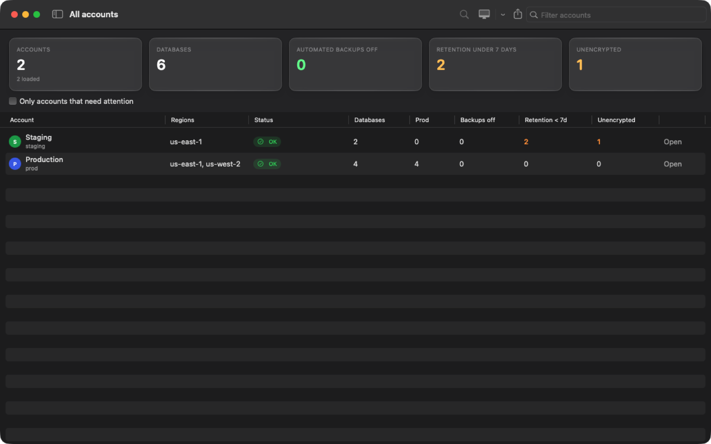
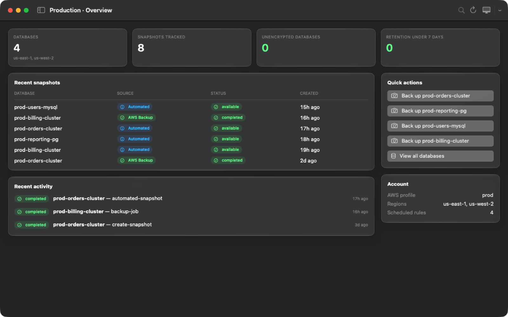
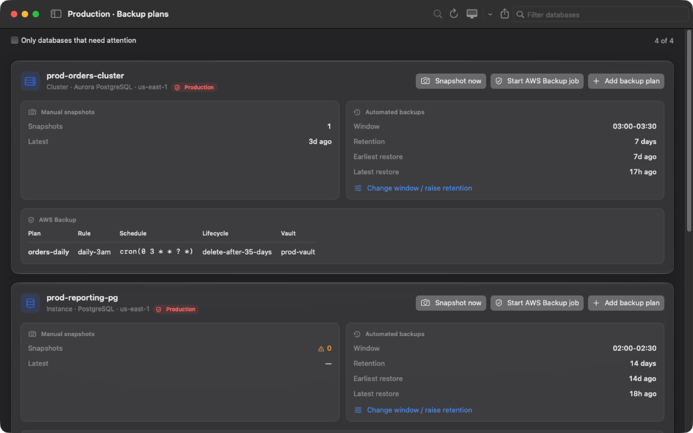
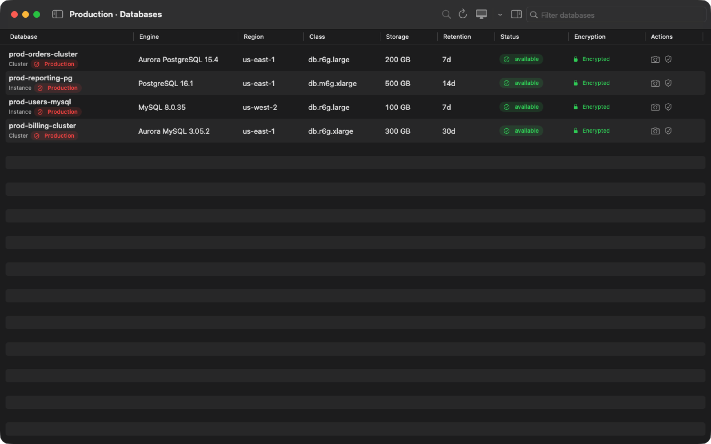
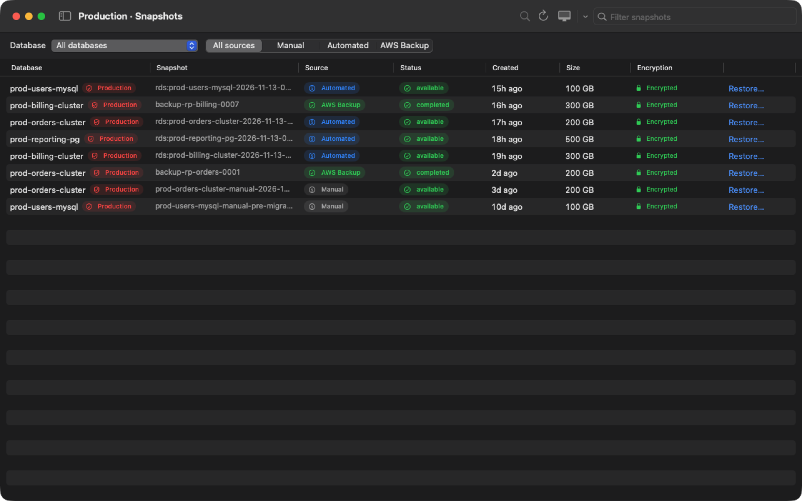
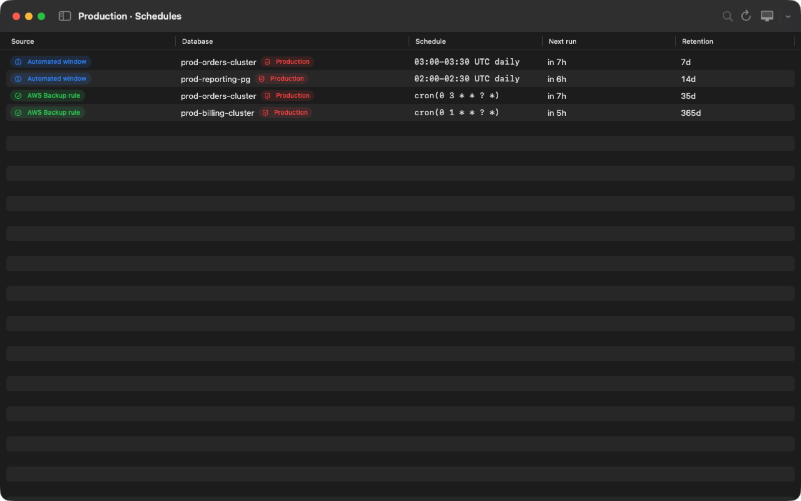

# AWS DB Backup Manager

A native macOS app for seeing and managing backups of Amazon RDS and Aurora databases across many AWS accounts. It uses the AWS profiles already on your Mac and shows every database with its manual snapshots, automated backups and AWS Backup recovery points side by side. You can take backups and restore to a **new** database.

**It never deletes anything.** No database, snapshot or recovery point can be deleted from this app. See [No-delete guarantee](#no-delete-guarantee).



*All screenshots use the app's built-in sample data.*

## Features

- **All accounts view** (⌘0): every account in one table, with totals for databases, automated backups switched off, retention under 7 days and unencrypted storage. You can filter to the accounts that need attention.
- **Backup plans per database:** manual snapshots, the automated backup window and retention, the earliest and latest restore points, and the AWS Backup plans that cover the database. Problems are highlighted in colour.
- **Snapshots:** manual snapshots, automated backups and AWS Backup recovery points in one list, filtered by database and source.
- **Take backups:** a manual snapshot, an on-demand AWS Backup job, or a new AWS Backup plan. You can also change the backup window or raise retention.
- **Restore wizard:** restore from a snapshot, a recovery point or a point in time, always to a new database. Production databases need their name typed before the restore starts.
- **Schedules and activity:** upcoming AWS Backup runs, plus recent backup jobs, restore jobs and RDS events.
- **Search, filters and CSV export:** search any list by name, engine, region, status or tag; show only databases that need attention; export Backup plans and All accounts to CSV for audits.
- **Read-only accounts:** mark an account read-only and every change button is disabled for it.
- **Built for many accounts:** AWS lookups are shared per region instead of repeated per database, so an account with 40 databases needs about 60 AWS requests to load, not about 1,260.

| Overview | Backup plans |
|---|---|
|  |  |

| Databases | Snapshots |
|---|---|
|  |  |



## Install

1. Download `AWS-DB-Backup-Manager-<version>-macos-universal.dmg` (or the `.zip`) from [Releases](../../releases). It runs on Apple Silicon and Intel Macs with macOS 15 or later.
2. Open the dmg and drag **AWS DB Backup Manager** onto **Applications**.
3. First launch: the app is ad-hoc signed, not notarized, so macOS blocks a double-click. Right-click the app in Applications, choose **Open**, then **Open** again. If macOS still refuses, run this once:

```bash
xattr -dr com.apple.quarantine "/Applications/AWS DB Backup Manager.app"
```

Each release lists checksums in `SHA256SUMS`: `shasum -a 256 -c SHA256SUMS`.

## Configure AWS accounts

The app reads `~/.aws/config` and `~/.aws/credentials`. It never stores keys.

1. Make sure each account has a profile. For IAM Identity Center (SSO):

```ini
[profile prod-db]
sso_session = my-org
sso_account_id = 111122223333
sso_role_name = DBBackupManager
region = ap-southeast-1

[sso-session my-org]
sso_start_url = https://my-org.awsapps.com/start
sso_region = ap-southeast-1
sso_registration_scopes = sso:account:access
```

Assume-role profiles (`role_arn` + `source_profile`) and static-key profiles also work.

2. In the app, open the account menu at the top of the sidebar and choose **Add account…**. Pick the profile from the list (it shows every profile in your AWS config), choose the regions to scan, and give the account a name and colour.
3. If an SSO session has expired, the account shows **Sign in with SSO**. That runs `aws sso login --profile <profile>` and opens your browser. It needs AWS CLI v2 installed (Homebrew `/opt/homebrew/bin/aws`, `/usr/local/bin/aws` or on `PATH`).

## Permissions

The person running the app needs AWS permissions in each account. Use the least-privilege policy in [`docs/iam-policy.json`](docs/iam-policy.json), explained in [`docs/iam-policy.md`](docs/iam-policy.md). Attach it to a dedicated permission set, not to an admin role.

**For an account you only want to look at,** mark it read-only in the app and give its profile a read-only role (for example only the `AppGuardAllowlistReadOnly` statement), so AWS stops writes too.

## No-delete guarantee

Independent layers, each enough on its own to stop a delete from this app:

1. **Closed operation set** ([`macos/Sources/ADBMCore/Guard.swift`](macos/Sources/ADBMCore/Guard.swift)). The AWS client can only send the 49 operations listed there, which match the Allow list in `docs/iam-policy.json` exactly. No destructive operation exists in that list, so no code path can express one.
2. **Runtime guard.** Every request is checked before it is signed. A pattern rejects anything named `Delete*`, `Remove*`, `Stop*`, `Reboot*`, `Failover*` or `Terminate*`, plus backup-plan updates, vault policy or lock changes and snapshot-sharing changes. Read-only accounts can't send any change.
3. **Parameter guards.** `ModifyDBInstance` and `ModifyDBCluster` may change only the backup window and retention, and retention can never go below 1 day, so automated backups can't be switched off. A new AWS Backup plan must keep recovery points for at least 7 days. A restore always creates a new database, and an existing name is rejected.
4. **Build-time tests.** `swift test` fails if any source file calls a destructive AWS operation or if the operation list drifts from the IAM policy.

The IAM policy adds one more layer outside the app: an explicit Deny on destructive RDS and AWS Backup actions.

Snapshots, restored databases and backup plans created through the app have to be removed by hand in the AWS console or CLI if you no longer want them.

## Build from source

The app is a Swift 6 package in [`macos/`](macos). It needs Xcode 16 or later (or the matching Swift toolchain) on macOS 15.

| Command | What it does |
|---|---|
| `cd macos && ADBM_FIXTURES=1 swift run ADBMApp` | Run with built-in sample data, no AWS calls |
| `make test-native` | All tests, including the no-delete and policy checks |
| `make policy-check-native` | Compare `docs/iam-policy.json` with the app's operation list |
| `make build-native-app` | Universal (Apple Silicon + Intel), ad-hoc signed `.app` in `macos/build/` |
| `make package-native` | Policy check, tests, universal build, then `dist/<version>/` with the `.dmg`, `.zip` and `SHA256SUMS` |

There's also a command-line tool for scripting and checks: `swift run adbm-cli list-accounts`, `list-databases --account <id>`, `list-snapshots`, `measure-load` and more (see `macos/Sources/adbm-cli/main.swift`).

The version is set in `macos/scripts/make-app.sh`. The bundle id is `com.dinhdobathi.awsdbbackupmanager`.

The Go and Wails code at the repository root is the earlier v0.1, kept as a reference. It is no longer shipped.

### Notarization (not set up)

To ship without the right-click step, the build needs:

1. An Apple Developer Program membership and a **Developer ID Application** certificate in the build Mac's keychain.
2. Signing with hardened runtime: `codesign --force --deep --options runtime --timestamp --sign "Developer ID Application: <Name> (<TEAMID>)" "macos/build/AWS DB Backup Manager.app"`.
3. Submitting and stapling: `xcrun notarytool submit dist/<version>/<file>.dmg --keychain-profile <profile> --wait`, then `xcrun stapler staple dist/<version>/<file>.dmg`.
4. In CI, the certificate and the notarytool App Store Connect API key go in as secrets, never in the repo.
